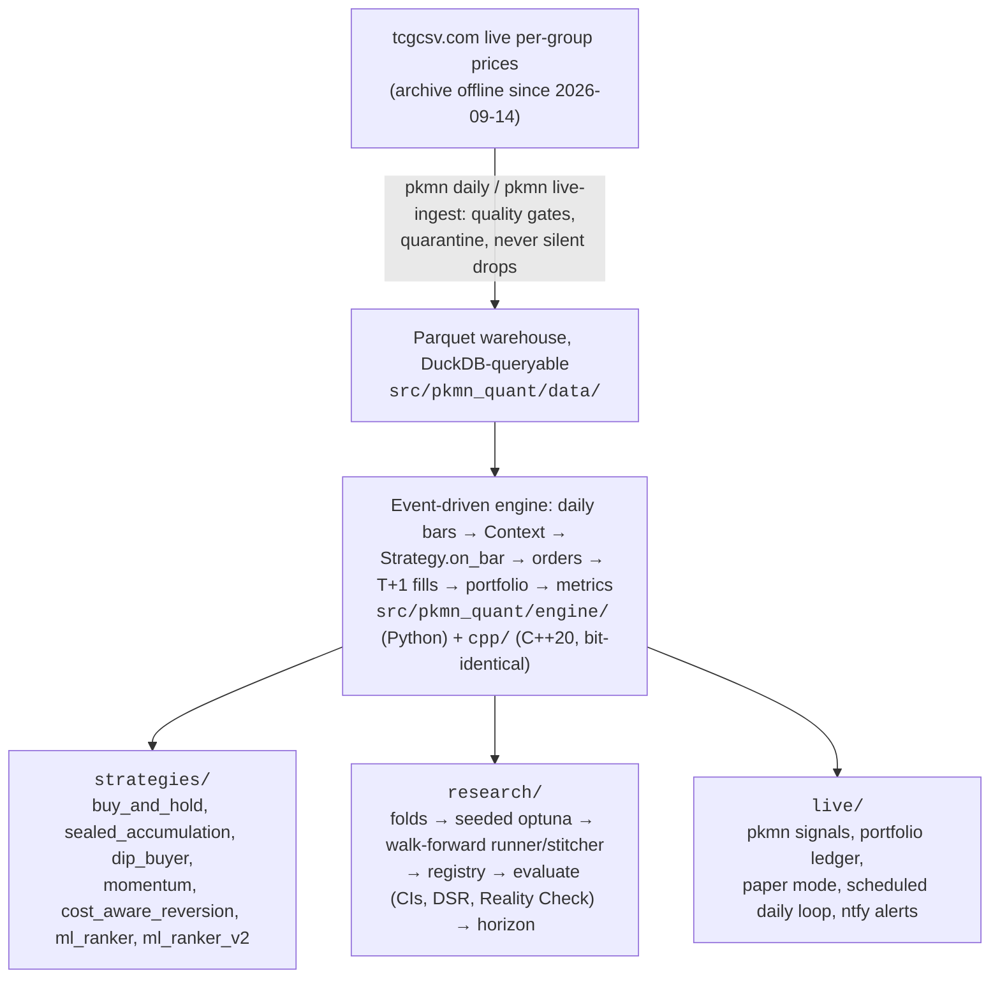
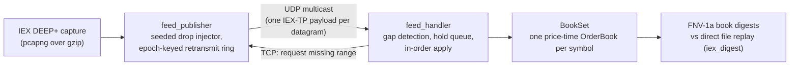

# pkmn_quant

**A backtester and order book engine: event-driven research on Pokemon card markets with bit-for-bit Python and C++ engines, plus a C++20 market-data stack that rebuilds real IEX order books and recovers them over lossy UDP multicast.**

[](https://github.com/mlhv/pkmn-stock/actions/workflows/ci.yml)


<p align="center">
  
</p>

*Stitched out-of-sample equity, 2024-08 to 2026-06, **on the 23-group price universe this project used through 2026-08-03**. This chart is kept as a historical artifact: prices now cover all 217 tcgcsv groups and the benchmark and buy-price instruments have since been repaired, so every number in it has moved. The current figures are in [Results](#results-walk-forward-out-of-sample-only). Regenerate with `uv run --group viz python scripts/render_readme_chart.py`.*

## Project status (paused 2026-10-27)

The project is done for now. Everything below is merged to `main` and passing every gate (753 pytest, 29 vitest, 205 Catch2, ruff, mypy strict).

| Track | What shipped |
|---|---|
| Card research | Python and C++ backtest engines with bit-for-bit parity, walk-forward validation, a market-impact cost model, block-bootstrap CIs, deflated Sharpe and White's Reality Check, horizon-matched per-trade scoring, an experiment registry, a web explorer |
| Data | A 217-group tcgcsv warehouse (38.2M price rows), and a live ingest loop with phone alerts since tcgcsv took its archive offline |
| Market data (Plan A) | A C++20 price-time order book and IEX DEEP+ decoder: 51M real messages at 7.3M msgs/sec, p50 83 ns |
| Pokemon book (Plan B) | Book execution against modelled resting orders, and an ITCH-style wire format with replay |
| Feed handler (Plan C) | UDP multicast replay with TCP retransmit recovery: 421,146 gaps recovered under 1% loss, books matching a direct replay at 508 of 508 checkpoints |

**Not done:** Plan D (re-running the research under book execution, side by side with the formula baseline), a second IEX oracle day on a normal session, and the items under [Future work](#future-work).

## What this is

A quant research system for TCGplayer card prices (via tcgcsv.com), built end to end, plus a market-data track on real exchange data:

- **A custom event-driven backtest engine**: daily bars, T+1 fills, long-only, integer quantities, per-day liquidity caps tiered by price, ~12.75% sell fees plus shipping, and a market-impact model that prices order size against the quote.
- **A native C++20 engine** (nanobind) that reproduces the Python engine **bit for bit**. Every fill and every equity value must match with `==`, never a tolerance, enforced at three levels (unit, differential, full-data acceptance).
- **An 18x faster research loop**: a full walk-forward dropped from 6 minutes to 20 seconds.
- **Real data at scale**: every one of tcgcsv's 217 Pokemon groups, 2024-02-08 to 2026-09-13, 38.2M price rows, rebuilt from cached archives in 17 minutes and swapped in only after every pre-existing row reproduced exactly. tcgcsv took its price archive offline on 2026-09-14, so new days now come from its live per-group endpoints (`pkmn live-ingest`, or `pkmn daily` four times a day). The days from 2026-09-14 to 2026-10-23 are lost, because the live endpoints only serve the current update.
- **Walk-forward validation only**: seeded optuna tunes parameters in-sample, they are frozen, then tested strictly out-of-sample. Every run reports its overfitting gap.
- **An experiment registry**: every run appends its config hash, git SHA, data fingerprint and results to an append-only log (`pkmn runs list` / `pkmn runs show`).
- **An IEX order book and feed handler in C++20**: decodes order-by-order DEEP+ captures, rebuilds every symbol's book, and keeps those books exact when the feed arrives over UDP multicast with packets dropped on purpose.

> **The honest headline:** no active strategy has beaten buy-and-hold sealed product here, on either price universe, under any cost model the project has used, or when scored over each trade's own holding window. The bar is a liquidity-screened buy-and-hold that puts 86.1% of the account into product (99.95% once fees and impact are counted) and returns **+126.84%** over 2024-03 to 2026-06. All six strategies lose out of sample (**-10.31% to -99.94%** stitched), White's Reality Check over the whole zoo is **p = 1.0000**, and over the target 1-3 month holding band the median trade loses to simply holding sealed over the same dates by **12 to 53 points**. The system's value is that it can prove and dismantle its own results: out-of-sample discipline, transaction-cost and market-impact realism, an explicit overfitting measurement, and reproducibility from a config hash.

## Results (walk-forward, out-of-sample only)

Current figures are the **formula baseline** re-run (2026-10-24/25): 217 groups, 2024-03-01 to 2026-06-30, impact on, `--execution formula`, 11 folds of 180 days in-sample and 60 out-of-sample, 15 trials per fold. Catalog sha256 `4cf6c3a6...` is pinned in the findings doc.

| Strategy | Stitched OOS | 95% CI | Sharpe | Deflated Sharpe |
|---|---:|---:|---:|---:|
| **buy-and-hold sealed** *(backtest, the bar)* | **+126.84%** | | 3.50 | |
| sealed-accumulation | -10.31% | [-24.22%, +4.57%] | -0.98 | 0.001 |
| xs-momentum | -35.16% | [-64.80%, +3.85%] | -1.12 | 0.000 |
| ml-ranker | -90.33% | [-99.37%, -20.30%] | -0.77 | 0.010 |
| cost-aware-reversion | -97.87% | [-99.93%, -73.01%] | -1.23 | 0.002 |
| dip-buyer | -99.17% | [-99.93%, -93.45%] | -2.50 | 0.000 |
| ml-ranker-v2 | -99.94% | [-100.00%, -85.51%] | -1.82 | 0.000 |

Deflated Sharpe is the probability that the true Sharpe is above zero after correcting for having tried six strategies; 0.5 is a coin flip, and every row is far below it. **Joint White's Reality Check: p = 1.0000**, meaning the best strategy did not beat even a typical best-of-six luck draw.

Caveats that change how to read the table:
- **The bar runs at `warmup_days=0` and the strategies at 120.** The screened benchmark is warmup-sensitive, and the published bar is the harder of the two, so the mismatch works against the strategies and flips nothing.
- **The bar's Sharpe is inflated** by mark smoothing in thin markets, and its -14.27% max drawdown is entry friction (the cost of buying into sealed inventory on day one), not market risk.
- **The ML results move with the product catalog.** TCGplayer dropped 104 release dates upstream between August and October; sealed-accumulation and both ML strategies read them. ML runs are deterministic on a fixed catalog, so pin the catalog sha256 with any run you want to reproduce.

**How the bar got here.** The benchmark has been measured four times, and the numbers are different allocation rules, not one market measured four times: +183.67% on the old 23-group universe (63.0% of the account invested all-in), +10.53% on 217 groups (5.5%, because equal-weighting 1,315 assets with integer quantities left 95% of the account as cash), +24.93% after a liquidity screen and cash sweep (99.9%, but 50% of it in one product that had not printed for 19 months), and +126.84% after an affordability filter (99.95%, largest position 2.23%). Never chart them as a series. Full derivation: [docs/research-findings-2026-07.md](docs/research-findings-2026-07.md).

**A correction this project published and fixed.** One `pkmn evaluate` run (`20260804T184401Z-cf292c`) reported p = 1.0000 where 0.8038 was correct, because it found its benchmark by globbing a directory name and picked up a stale pre-swap one. The error made the test harder, never easier. The glob is gone: `pkmn evaluate` now resolves its benchmark from the run registry only and refuses one whose window does not cover the strategies'.

### Does anything beat holding sealed over 1-3 months?

This is the question the project set out to answer, and a stitched 28-month return cannot: it scores a strategy that is in the market a third of the time against one that is in it every day. `pkmn horizon` pairs a backtest's fills into FIFO round trips and scores each trip against holding the sealed index **over that trip's own entry and exit dates**, with still-open trips scored net of a modelled exit.

| Strategy | Backtest total return | Round trips | Trips in 1-3m | **1-3m median edge** | 1-3m trips beating the index |
|---|---:|---:|---:|---:|---:|
| sealed-accumulation | +6.22% | 32 | **2** | -11.96% | 1 of 2 |
| cost-aware-reversion | -98.41% | 125 | 35 | -22.66% | 8 of 35 |
| ml-ranker | -99.81% | 121 | 104 | -44.62% | 10 of 104 |
| xs-momentum | -98.69% | 170 | 159 | -49.00% | 2 of 159 |
| dip-buyer | -99.71% | 164 | 115 | -52.88% | 1 of 115 |
| ml-ranker-v2 | *no result* | | | | |

**The answer is no, and not narrowly.** The only positive band figure anywhere is xs-momentum's 3-6 month +45.63% over 8 trips; never quote it without the 8. ml-ranker-v2 has no horizon result because its backtest was killed after a 21-hour swap thrash. Method caveat: walk-forward artifacts carry no `fills.parquet`, so these come from **default-parameter backtests** over the same window, not the tuned parameter sets.

## Why the numbers are believable

- **No look-ahead by construction:** strategies receive a `Context` (history up to today, positions, cash) and cannot tell backtest from live mode.
- **Cost realism:** ~15% round-trip friction before impact. A buy's base price is floored at `max(market, low)`, because `market` is a sales-derived print and `low` is the cheapest current listing, so you cannot buy below an offer that exists. The impact model then walks fills from that floor toward `mid` (buys) or from `market` toward `low` (sells), scaled by order size against the daily liquidity cap. Sells have no floor on purpose: tcgcsv publishes no bid series, so a symmetric fix would be fabricating a price. On the current bar, impact is 15.3% of buy notional. `--no-impact` also disables the buy floor, so flat-cost runs are a comparability tool, not a model of executable prices.
- **A bar that is actually invested:** the benchmark screens the sealed universe for tradeability (print density, then relative spread), keeps only assets the account can afford at equal weight, and sweeps residual cash. It is deliberately **not** walk-forward-searchable: tuning the bar to maximise its own return would make every comparison against it self-serving.
- **Walk-forward only:** parameters are frozen before touching out-of-sample data.
- **Reproducible:** every run's config hash, git SHA (+dirty flag), and data fingerprint, including the catalog sha256 since 2026-10-26, land in the registry.
- **Stated limitations:** ~2.5 years of data, one bull regime for sealed. Sharpe and Sortino are inflated by thin-market mark smoothing across ~31,700 priced products. tcgcsv publishes a daily `market` price whether or not anything sold, so "prints every day" is not "trades every day". About 6% of price rows have `market` below the day's lowest listing; buys are priced at the listing, but no filter removes those products from a strategy's candidates. Stitched seams assume mark-value carryover without liquidation costs. Methodology over significance.

## Architecture





Data throughout the card pipeline is polars-backed; `research/features.py` holds the leakage-bounded ML features (scikit-learn).

## Two engines, one result

The Python engine (`engine/backtest.py`) is the always-available reference. The C++ engine (`cpp/`, bound as `pkmn_quant._engine`) ports all five rule strategies natively. `pkmn backtest` is native-only; `pkmn walkforward` exposes `--engine cpp`/`--engine python`, defaulting to `cpp`. Anything else, including any raw Python `Strategy` such as ml-ranker, still runs on the C++ event loop through a per-bar callback bridge.

**The parity guarantee is bit-for-bit, not "close enough".** Every fill's day, asset, quantity, price, fees and impact, and every equity-curve value, must match exactly (`==`). Enforced three ways: Catch2 unit tests on the C++ core in isolation, differential tests across both engines for every strategy, and a full-data acceptance script over the real warehouse:

```bash
uv run python scripts/parity_full.py        # five rule strategies, ~1 min
uv run python scripts/parity_full.py --ml   # + ml-ranker bridge, ~2-3 min
```

The full-data acceptance run surfaced a real gap the synthetic fixtures never exercised: priced products with no catalog row, because TCGplayer re-files products between groups and the catalog fetch only covered the price-tracked ones. Both engines now tag missing catalog rows kind `other` and agree bit for bit on which assets are tradeable, and the catalog now covers all 217 groups on every ingest. The residual is 112 of ~31,700 priced products (0.35%), most likely delisted upstream.

**Measured single-backtest speedup** (best of 3, full 2024-03 to 2026-06 range, impact on, total wall-clock including the one-time data load, on the 23-group warehouse of the time):

| strategy | python (s) | cpp (s) | speedup |
|---|---|---|---|
| buy-and-hold | 10.34 | 4.37 | 2.4x |
| sealed-accumulation | 11.91 | 3.52 | 3.4x |
| dip-buyer | 27.44 | 3.60 | 7.6x |

**Measured walk-forward speedup** (`scripts/bench_walkforward.py`, sealed-accumulation, 11 folds, 15 trials per fold):

| config | wall-clock (s) | speedup |
|---|---|---|
| python, serial | 359.5 | 1.0x |
| cpp, serial | 20.0 | 18.0x |
| cpp, workers=auto | 20.5 | 17.5x |

`--workers` controls fold-level parallelism (0 = auto, 1 = serial, N = N threads); results are bit-identical at any worker count. The 18x is almost entirely the native engine plus a data-prep hoist, not threads; the findings doc's Plan 11 section explains why. Run the ML strategies with `--workers 1`: they hold the GIL through the Python bridge, and fold parallelism only multiplies their memory.

Build notes: `uv sync` builds the extension automatically (scikit-build-core + nanobind, CMake ≥ 3.26). For direct C++ iteration:

```bash
cmake -S cpp -B cpp/build -DPKMN_BUILD_TESTS=ON && cmake --build cpp/build -j
ctest --test-dir cpp/build --output-on-failure
```

## Quickstart

```bash
uv sync --group api --group dashboard                     # installs everything, builds the C++ extension
uv run pytest                                             # 753 tests
uv run pkmn live-ingest                                   # capture tcgcsv's current update (the archive is offline)
uv run python scripts/rebuild_warehouse.py --root .       # rebuild history from cached raw archives, ~17 min
uv run python scripts/verify_rebuild.py --root .          # gate any swap: prices, quarantine and catalog must reproduce exactly
uv run pkmn backtest --start 2024-03-01 --end 2026-06-30 --execution formula   # the bar, as in Results
uv run pkmn walkforward --strategy sealed-accumulation \
    --start 2024-03-01 --end 2026-06-30 --trials 15 --execution formula        # research run
uv run pkmn evaluate --execution formula                  # CIs, deflated Sharpe, Reality Check
uv run pkmn horizon <backtest-run-id>                     # per-trade edge vs holding sealed over each trade's own window
uv run pkmn signals --strategy sealed-accumulation        # today's recommendations
uv run pkmn runs list                                     # experiment registry
uv run pkmn daily --skip-ingest --paper                   # paper-trade the full loop, offline
uv run --group dashboard streamlit run app/dashboard.py   # results explorer
```

`pkmn backtest`, `pkmn walkforward` and `pkmn evaluate` default to `--execution book` (see [Pokemon order book](#pokemon-order-book)). Every number in this README is formula, so pass `--execution formula` to reproduce them; book and formula results are never mixed.

<details>
<summary><strong>Scheduling the daily loop (macOS launchd)</strong></summary>

    sed "s|REPO_PATH|$(pwd)|" scripts/com.pkmn-quant.daily.plist \
        > ~/Library/LaunchAgents/com.pkmn-quant.daily.plist
    launchctl bootstrap gui/$(id -u) ~/Library/LaunchAgents/com.pkmn-quant.daily.plist

Runs `pkmn daily` at 09:00, 13:00, 17:00 and 21:00 (or on next wake, if the
Mac was asleep): captures tcgcsv's live update if it is not stored yet, runs
signals against your ledger (`pkmn portfolio ...`) when a new day landed, and
notifies when there is something to act on or a problem worth acting on.
Notifications are a macOS banner, plus a phone push through ntfy if
`data/config/notify.toml` holds an `[ntfy]` topic (`pkmn notify-test` checks
it). Editing the plist in the repo does nothing to the installed copy:
`launchctl bootout` and bootstrap it again.

Troubleshooting:

    launchctl kickstart gui/$(id -u)/com.pkmn-quant.daily       # fire immediately to test
    launchctl list | grep pkmn-quant                            # loaded? last exit code?

</details>

<details>
<summary><strong>Paper trading before real money</strong></summary>

Run the loop with `--paper` first (`uv run pkmn daily --skip-ingest --paper`,
or a second launchd job pointing at the same repo). Paper mode routes all
ledger reads and writes to `data/portfolio/paper.jsonl`, records fills with
the same CostModel as the backtester (shipping, marketplace fee, per-day
liquidity cap), and labels every output PAPER: the dashboard alerts strip,
notification titles, and the `daily-{date}-paper/` artifact directory. Fill
counts in `daily.json` count recorded fills only, after liquidity and
affordability clipping, so a paper day where every order clips to zero sends
no notification. All six active strategies are portfolio-safe: each supports
`--portfolio` for exit signals against a real ledger and works with the paper
daily loop.

</details>

## Web explorer

A research explorer over the experiment registry and walk-forward/evaluate
artifacts that can also trigger new runs: browse recorded runs, launch a
parameterized backtest (any strategy, any params, optional starting holdings)
from a form generated off the strategy's declarative parameter specs, watch it
through a polling jobs queue, and open the finished run's detail screen, with
the equity curve overlaid on an identical-starting-state buy-and-hold
benchmark, seeded-exit markers and a paginated fills table. It also drills into
a single walk-forward run's folds and rigor CI, and compares the whole strategy
zoo's deflated Sharpe and Reality Check side by side. Stack: FastAPI
(`src/pkmn_quant/api/`, 11 endpoints) serving Pydantic-typed JSON, and a
React/TS single-page app (`web/`, 6 screens) with its own toolchain.

```bash
make web    # API + web dev server together; Ctrl-C stops both
```


This is a research tool, not a trading terminal. A triggered run writes a real
artifact directory and registry record (there is no sandbox mode), job state
lives in memory (a restart loses the queue, never the results), and the product
search index is cached per process.

## Market data: an IEX order book in C++

The market-data track has four planned pieces: (A) an IEX order book, (B) a Pokemon order book, (C) a feed handler, and (D) a research re-run under book execution. A, B and C are done; D is not started.

Piece A is a C++20 price-time order book (`cpp/src/pkmn_book`) and an IEX market-data stack (`cpp/src/pkmn_md`) that decodes the order-by-order DEEP+ feed straight from gzipped pcapng captures and rebuilds every symbol's book.

**Speed.** Decoding and applying all 50,959,176 DEEP+ messages in the 2024-12-23 capture, held in RAM, runs at 7,342,902 messages per second (best of 3, 13.5% spread). Per-message latency: p50 83 ns, p99 626 ns, p99.9 6,448 ns. The timer is the ARM virtual counter at 41.7 ns per tick, so the p50 is two ticks and carries ±50%. Replacing node-based containers with a pooled order arena, an open-addressing id table and contiguous price levels took best-case throughput from 4,926,764 to 7,584,533 messages per second, faster in all 9 interleaved A/B pairs; tail latency did not improve. Hardware is an Apple M1 Pro running a 7-vCPU OrbStack Ubuntu 24.04 VM, where run-to-run noise is 10% or more. Method and raw runs: [docs/benchmarks/iex-book.md](docs/benchmarks/iex-book.md).

**What the oracle checks, and what it does not prove.** `iex_oracle` compares the rebuilt book against IEX's own DEEP price levels and TOPS best quotes. On 2024-12-23 it checked 96,974,545 points and 7,870 disagree (0.008%), across 8 symbols, so **the oracle did not pass on that day** (the bar was a match at every point). 7,819 of the 7,870 follow a point at 09:48:38 ET where DEEP+ order ids start running backwards, which no IEX specification documents; the other 51 are three symbols whose round lot is not 100. The day is also an incident day, not a normal session: every symbol halted at 10:22:29 ET and all feeds restarted at 11:32:50 ET. The next oracle day should be an ordinary session. Details: [docs/iex-oracle.md](docs/iex-oracle.md).

Data provided for free by IEX. By accessing or using IEX Historical Data, you agree to the IEX Historical Data Terms of Use. The data is not redistributed here (`data/iex/` is gitignored); see [docs/iex-hist-terms.md](docs/iex-hist-terms.md).

## Feed handler: gap recovery over UDP multicast

Exchanges publish market data over UDP multicast, which is fast and reaches every subscriber at once but can lose packets, and serve recovery over TCP. Piece C follows that design. `feed_publisher` replays the 2024-12-23 DEEP+ capture as UDP multicast, one datagram per IEX-TP payload, byte for byte unchanged, and drops packets on purpose with a seeded injector. `feed_handler` finds each gap by sequence number, holds the packets behind it, asks the publisher for the missing range over TCP, and applies every message in order. The capture contains a mid-session exchange restart where sequence numbers start over; the handler treats it as a new epoch and survives losing the restart packet itself.

To prove the books are right, the handler and a direct replay of the file each take a digest of every resting order (price, quantity, queue position) every 100,000 messages and at each epoch end.

| Run | Packets dropped | Gaps recovered | Unrecoverable | Checkpoints matching | Throughput |
|---|---:|---:|---:|---:|---:|
| 1% random loss | 425,623 | 421,146 | 0 | 508 of 508 | 657,789 msgs/s |
| 100-packet bursts | 2,018,900 | 20,175 | 0 | 508 of 508 | 677,599 msgs/s |
| No injected loss, RAM-preloaded | 0 | | 0 | all | 768,150 msgs/s |

The publisher, not the handler, was the limit: it never reached any paced target, so 768,150 msgs/s is a floor and the handler's ceiling was not found. At an 8M target the handler's receive buffer overflowed, and 3,399 datagrams were lost and recovered through 1 gap. Limits, stated plainly: loopback inside one VM, not a network; retransmit only, no snapshot recovery; checkpoints are samples, and the 80,992-message epoch after the restart has none; and the reference shares the decoder and order book with the handler, so a match proves the transport and recovery, not agreement with IEX. Details: [docs/benchmarks/feed-handler.md](docs/benchmarks/feed-handler.md).

Data provided for free by IEX. By accessing or using IEX Historical Data, you agree to the IEX Historical Data Terms of Use. The data is not redistributed here (`data/iex/` is gitignored); see [docs/iex-hist-terms.md](docs/iex-hist-terms.md).

## Pokemon order book

Piece B made the backtester's default execution a price-time order book. tcgcsv publishes one quote per product per day, not an order book, so the resting orders are **modelled (synthetic, built from the day's tcgcsv quote)**, never market data. Two checks back it. With a test-only exact ladder, book pricing matches the walk-the-spread formula to 4.66e-10 dollars across 11.2 billion checks on 34.1 million real rows, and the five native strategies fill identically under both at default parameters. Encoding the warehouse into an ITCH-style wire file (`pkmn wire encode`, [docs/pokemon-wire-protocol.md](docs/pokemon-wire-protocol.md)) and replaying it builds the same ladders as the in-memory path, with no mismatches over 1,315,694 asset-days. This is an engine change, not a research result: re-running the research under it is Plan D. Measurements: [docs/benchmarks/pokemon-book.md](docs/benchmarks/pokemon-book.md).

## Engineering practices

- `uv` for everything; `ruff` lint + format; `mypy --strict` on `src/`; pytest, vitest and Catch2; CI runs all gates with `uv sync --frozen`.
- Golden regression tests pin exact engine numbers; any drift fails loudly.
- Frozen dataclasses for value objects; every backtest `Result` carries its cost model, so a run's assumptions travel with its numbers.
- A written spec and plan per feature, with a review per task and a whole-branch review before merge (see `docs/superpowers/`).
- Negative results and corrections are published, not dropped: [docs/research-findings-2026-07.md](docs/research-findings-2026-07.md).

## Future work

- **Plan D: the research re-run under book execution**, side by side with the formula baseline above.
- **A liquidity / quote-sanity layer.** About 6% of rows have `market` below the day's lowest listing, and dip-buyer and cost-aware-reversion select straight into them. `research/screen.py` is the machinery a universe filter needs; that full-zoo re-run has not been done.
- **Fills in walk-forward artifacts**, so `pkmn horizon` can score tuned parameter sets instead of default-parameter backtests.
- **ml-ranker-v2's horizon result**, which needs its backtest's memory growth fixed first.
- **A versioned product catalog**, so ML results stop moving when TCGplayer edits upstream metadata.
- **A second IEX oracle day** on a normal session, and an answer on the DEEP+ order-id rewind.
- **The feed handler's real throughput ceiling**, which needs a faster publisher (for example batched sends with `sendmmsg`) and ideally two hosts on a real network.
- Multi-marketplace data (eBay, PSA-graded).
