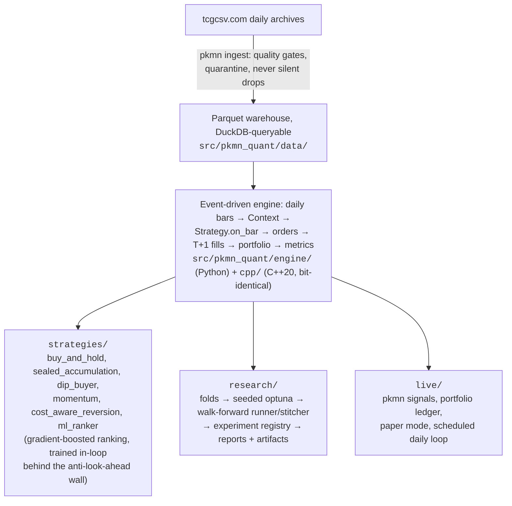

# pkmn_quant

**Event-driven backtesting for Pokemon card markets: a Python reference engine, a bit-for-bit-identical C++ engine, and walk-forward research honest enough to publish its own negative result.**

[](https://github.com/mlhv/pkmn-stock/actions/workflows/ci.yml)


<p align="center">
  
</p>

*Stitched out-of-sample equity, 2024-08 to 2026-06, **on the 23-group price universe this project used through 2026-08-03**. Each strategy shows its most rigorous available run at that time: sealed-accumulation and ml-ranker include the market-impact cost model, the rest are flat-cost, and the legend says which. Prices now cover all 217 tcgcsv groups and every number in this chart moved — see [Results](#results-walk-forward-out-of-sample-only) below. Regenerate with `uv run --group viz python scripts/render_readme_chart.py`.*

## What this is

A quant research system for TCGplayer card prices (via tcgcsv.com), built end to end:

- **A custom event-driven backtest engine**: daily bars, T+1 fills, long-only, integer quantities, per-day liquidity caps tiered by price, ~12.75% sell fees plus shipping, and a walk-the-spread market-impact model that prices order size against the book.
- **A native C++20 engine** (nanobind) that reproduces the Python engine **bit for bit**. Every fill and every equity value must match with `==`, never a tolerance, enforced at three levels (unit, differential, full-data acceptance).
- **An 18x faster research loop**: a full walk-forward dropped from 6 minutes to 20 seconds, measured on the real 874-day / 23-group warehouse of the time, with fold-level parallelism that releases the GIL on the native path.
- **Real data at scale**: 908 daily snapshots (2024-02 to 2026-08) of every one of tcgcsv's 217 Pokemon groups — 36.4M price rows across 31,713 products, rebuilt from cached archives in 17 minutes and swapped in only after every pre-existing row was verified to reproduce bit-for-bit.
- **Walk-forward validation only**: seeded optuna tunes parameters in-sample, they are frozen, then tested strictly out-of-sample. The headline curve contains zero in-sample days and every run reports its overfitting gap.
- **An experiment registry**: every run appends its config hash, git SHA, data fingerprint, and results to an append-only log (`pkmn runs list` / `pkmn runs show`), so any number in this README is reproducible.

> **The honest headline:** no active strategy has ever beaten buy-and-hold sealed product here, on either universe this project has measured. On the narrow 23-group universe used through 2026-08-03, buy-and-hold returned +183.7% full-period with the impact model on while every active strategy was negative. Widening prices to all 217 groups did not change that ordering — but it did expose that the benchmark itself is a weak bar on the wide universe (it sits 95% in cash, an equal-weight integer-sizing artifact) and that four strategies lose almost everything once thin, quote-inconsistent products enter their candidate set. The system's value is that it can prove and dismantle its own results honestly: out-of-sample discipline, transaction-cost and market-impact realism, an explicit overfitting measurement, and reproducibility from a config hash.

## Results (walk-forward, out-of-sample only)

**Prices cover all 217 tcgcsv groups as of 2026-08-04** (previously 23: sets released since 2024). The universe is derived from what is priced, so widening ingestion widened every strategy's candidate set — 6,671 → 31,713 priced products, 3.2M → 36.4M price rows — and every number below moved. Both columns are **impact-on** over the identical window (2024-03-01..2026-06-30, 11 folds, 15 trials), so the only difference is the universe. Run IDs are in `data/runs/registry.jsonl` and cited in the findings doc.

| Strategy             | Stitched OOS, 23 groups | Stitched OOS, 217 groups |
|----------------------|-------------------------:|--------------------------:|
| buy-and-hold sealed  | *(full-period backtest)* **+183.7%** | *(full-period backtest)* **+10.5%** |
| sealed-accumulation  | −7.4%                    | **−8.6%**                  |
| ml-ranker            | −5.1%                    | **−81.6%**                 |
| xs-momentum          | −9.3%                    | **−38.7%**                 |
| dip-buyer            | −21.2%                   | **−99.8%**                 |
| cost-aware-reversion | −22.5%                   | **−98.7%**                 |
| ml-ranker-v2         | −23.2%                   | **−99.8%**                 |

11 folds each: optimize 180 days in-sample, freeze params, test 60 days out-of-sample, roll, stitch the OOS segments. The overfitting gap (mean IS CAGR minus mean OOS CAGR) is reported on every run. White's Reality Check over the whole zoo is **p = 1.0000 on both universes** — the best candidate does not beat a typical best-of-six luck draw.

**Neither headline movement means what it looks like.** The benchmark's fall is mostly a sizing artifact: `BuyAndHold` equal-weights the sealed universe with integer quantities, so 45 → 1,315 day-1 assets took the per-asset budget from $222 to $7.60 and deployed capital from 60.1% to 4.7% of a $10,000 account. Neither run was fully deployed — on the slice actually at risk the two returned +291.7% and +191.1%, so about 90% of the 17x headline collapse is the sizing rule rather than the assets. The obvious "the new products are junk" explanation is falsified: newly added sealed products returned a median +212% over the window versus +171% for the pre-existing ones. The near-total losses of dip-buyer and cost-aware-reversion are adversarial selection — 92-97% of their buy-side impact comes from fills where the day's `market` print sits *below the lowest listing*, and both strategies are by construction maximizers over exactly the quantity that inconsistency corrupts. **Those impact figures come from fixed-parameter diagnostic probes, not from the walk-forward runs in the table**, and the two ML strategies' losses were **not** diagnosed at all. Full derivation, provenance for every derived figure, and the three things that remain unexplained: [docs/research-findings-2026-07.md](docs/research-findings-2026-07.md).

## Why the numbers are believable

- **No look-ahead by construction:** strategies receive a `Context` (history up to today, positions, cash) and cannot tell backtest from live mode.
- **Cost realism:** ~15% round-trip friction before impact; the impact model walks fills from `market` toward `mid` (buys) or `low` (sells), scaled by order size against the daily liquidity cap. Opt out per-command with `--no-impact`.
- **Walk-forward only:** parameters are frozen before touching out-of-sample data; zero in-sample days in the headline curve.
- **Reproducible:** every run's config hash, git SHA (+dirty flag), and data fingerprint land in the registry.
- **Stated limitations:** ~2.5 years of data, one bull regime for sealed; Sharpe/Sortino are inflated by thin-market mark smoothing, now across 31,713 products rather than 6,671, so worse than before (documented in every report); tcgcsv publishes a daily `market` price whether or not anything sold, so "prints every day" (22,677 products) is not "trades every day"; ~6% of price rows have `market` below the day's lowest listing, which no liquidity or quote-sanity filter currently screens out; stitched seams assume mark-value carryover without liquidation costs. Methodology over significance.

## Architecture



The market-impact model lives in `engine/quotes.py`: a per-day `Quote` (mid/low) feeds walk-the-spread pricing (engine default off, CLI default on). Data throughout the pipeline is polars-backed; `research/features.py` adds 8 leakage-bounded features for ml-ranker (scikit-learn).

## Two engines, one result

The Python engine (`engine/backtest.py`) is the always-available reference. The C++ engine (`cpp/`, bound as `pkmn_quant._engine`) ports all five strategies natively. `pkmn backtest` is native-only (no `--engine` flag); `pkmn walkforward` still exposes `--engine cpp`/`--engine python`, defaulting to `cpp` since Plan 11. Anything else, including any raw Python `Strategy` such as ml-ranker, still runs correctly on the C++ event loop through a per-bar callback bridge.

**The parity guarantee is bit-for-bit, not "close enough".** Every fill's day, asset, quantity, price, fees, and impact, and every equity-curve value, must match exactly (`==`). Enforced three ways: Catch2 unit tests on the C++ core in isolation, differential tests across both engines for every strategy, and a full-data acceptance script over the real warehouse (874 days / 23 groups when that acceptance was run; 908 days / 217 groups today):

```bash
uv run python scripts/parity_full.py        # five rule strategies, ~1 min
uv run python scripts/parity_full.py --ml   # + ml-ranker bridge, ~2-3 min
```

The full-data acceptance run surfaced a real gap the synthetic fixtures never exercised: 40 priced product_ids inside the backtest window (1,845 warehouse-wide as of that run) had no matching `products.parquet` catalog row. Both engines now tag missing catalog rows kind `other`, so they agree bit-for-bit on which assets are tradeable; details in the findings doc's Plan 10 section. The underlying gap has since been **fixed** — the catalog now covers all 217 tcgcsv groups on every ingest, which took uncataloged priced products from 2,017 (the re-measured warehouse-wide figure) to 8 of 6,665 on the 23-group warehouse. On the current 217-group warehouse the residual is 112 of 31,713 (0.35%) — products delisted upstream that keep their price history but no longer appear in the catalog; the kind-`other` tagging stays as the safety net for them.

**Measured single-backtest speedup** (best of 3, full 2024-03 to 2026-06 range, impact on, total wall-clock including the one-time data load):

| strategy | python (s) | cpp (s) | speedup |
|---|---|---|---|
| buy-and-hold | 10.34 | 4.37 | 2.4x |
| sealed-accumulation | 11.91 | 3.52 | 3.4x |
| dip-buyer | 27.44 | 3.60 | 7.6x |

**Measured walk-forward speedup** (`scripts/bench_walkforward.py`, sealed-accumulation, 11 folds, 15 trials per fold):

| config | wall-clock (s) | speedup |
|---|---|---|
| python, serial | 359.5 | 1.0x |
| cpp, serial | 20.0 | 18.0x |
| cpp, workers=auto | 20.5 | 17.5x |

`--workers` controls fold-level parallelism (0 = auto, 1 = serial, N = N threads); results are bit-identical at any worker count, and the serial/parallel equality is checked on real data by the benchmark itself. The honest detail: the 18x is almost entirely the native engine plus a data-prep hoist, not threads; the findings doc's Plan 11 section explains why. Use `--engine python --workers 1` for the reference behavior.

Build notes: `uv sync` builds the extension automatically (scikit-build-core + nanobind, CMake ≥ 3.26). For direct C++ iteration:

```bash
cmake -S cpp -B cpp/build -DPKMN_BUILD_TESTS=ON && cmake --build cpp/build -j
ctest --test-dir cpp/build --output-on-failure
```

## Quickstart

```bash
uv sync                                                   # installs everything, builds the C++ extension
uv run pytest                                             # 520 tests (+1 dashboard skip without --group dashboard)
uv run pkmn ingest --start 2024-02-08 --end 2026-08-03    # all 217 groups; hours from cold, ~36M price rows
uv run python scripts/rebuild_warehouse.py --root .       # ~17 min instead, if the raw archives are already cached
uv run python scripts/verify_rebuild.py --root .          # gate any swap: every pre-existing product must reproduce exactly
uv run pkmn refresh-products                              # repair the product catalog (all 217 groups, no prices)
uv run pkmn backtest --start 2024-03-01 --end 2026-06-30  # benchmark backtest (cpp engine, impact on)
uv run pkmn walkforward --strategy sealed-accumulation \
    --start 2024-03-01 --end 2026-06-30 --trials 15       # research run (fold-parallel by default)
uv run pkmn signals --strategy sealed-accumulation        # today's recommendations
uv run pkmn runs list                                     # experiment registry
uv run pkmn portfolio show                                # real positions + P&L
uv run pkmn daily --skip-ingest --paper                   # paper-trade the full loop, offline
uv run --group dashboard streamlit run app/dashboard.py   # results explorer
```

<details>
<summary><strong>Scheduling the daily loop (macOS launchd)</strong></summary>

    sed "s|REPO_PATH|$(pwd)|" scripts/com.pkmn-quant.daily.plist \
        > ~/Library/LaunchAgents/com.pkmn-quant.daily.plist
    launchctl load ~/Library/LaunchAgents/com.pkmn-quant.daily.plist

Runs `pkmn daily` at 09:00 (or on next wake, if the Mac was asleep at 09:00):
ingests new prices, runs signals against your ledger (`pkmn portfolio ...`),
and sends a macOS notification when there is something to act on, or when the
run fails.

Troubleshooting:

    launchctl start com.pkmn-quant.daily                        # fire immediately to test
    launchctl list | grep pkmn-quant                            # loaded? last exit code?
    launchctl unload ~/Library/LaunchAgents/com.pkmn-quant.daily.plist   # required before re-loading an edited plist

</details>

<details>
<summary><strong>Paper trading before real money</strong></summary>

Before committing real cash, run the loop with `--paper` first
(`uv run pkmn daily --skip-ingest --paper`, or a second launchd job pointing
at the same repo).  Paper mode routes all ledger reads and writes to
`data/portfolio/paper.jsonl`, auto-records fills using the same CostModel
as the backtester (shipping, marketplace fee, per-day liquidity cap), and
labels every output surface PAPER: the dashboard alerts strip, notification
titles, and the `daily-{date}-paper/` artifact directory.  Fill counts in
`daily.json` reflect recorded fills only (after liquidity and affordability
clipping, not raw recommendations), so a paper day where every order clips to
zero sends no notification.  Use it to watch the strategy trade fake money
through the identical pipeline before you act on any real recommendation.
All five strategies (sealed-accumulation, dip-buyer, cost-aware-reversion,
xs-momentum, ml-ranker) are portfolio-safe: each supports `--portfolio` for
exit signals against a real ledger and works with the paper daily loop.

</details>

## Web explorer

A research explorer over the experiment registry and walk-forward/evaluate
artifacts, with the ability to trigger new runs from the browser: browse
recorded runs, launch a parameterized backtest (any strategy, any params,
optional starting holdings) from a form generated off the strategy's
declarative parameter specs, watch it through a polling jobs queue, and open
the finished run's detail screen — equity curve overlaid with an
identical-starting-state buy-and-hold benchmark, seeded-exit markers, and a
paginated fills table. Also: drill into a single walk-forward run's
folds/equity curve/rigor CI, and compare the full strategy zoo's
deflated-Sharpe/Reality-Check numbers side by side. Stack: FastAPI
(`src/pkmn_quant/api/`, 11 endpoints) serving Pydantic-typed JSON, and a
React/TS single-page app (`web/`, 6 screens) with its own toolchain.

One-command dev (runs both the API and the web dev server together, Ctrl-C
stops both):

```bash
make web
```


This is a research tool, not a trading terminal: no strategy is claimed to
beat buy-and-hold, and a triggered run writes a real artifact directory plus
a run-registry record — there is no sandbox mode. Job state lives in memory
(a server restart loses the jobs queue, never the results); the product
search index is cached per process, so a fresh ingest needs a restart to
become searchable; and holdings that fail universe/mark validation surface
as a failed job rather than a form error.

## Engineering practices

- `uv` for everything; `ruff` lint + format; `mypy --strict` on `src/`; pytest + Catch2; CI runs all gates with `uv sync --frozen`.
- Golden regression tests pin exact engine numbers; any drift fails loudly.
- Frozen dataclasses for value objects; every backtest `Result` carries its cost model, so a run's assumptions travel with its numbers.
- Two-stage review per task and a written plan per feature (see `docs/superpowers/`).

## Future work

- **A liquidity / quote-sanity layer.** The wide universe contains ~6% of rows where `market` sits below the day's lowest listing; dip-buyer and cost-aware-reversion select straight into them. Nothing currently screens them out, and no strategy result on the wide universe should be read as a measure of edge until something does.
- **Benchmark sizing.** Equal-weighting integer quantities across 1,315 sealed assets leaves a $10,000 account 95% in cash, so the buy-and-hold bar is not currently meaningful. Needs proportional sizing, a capped universe, or a larger notional.
- Multi-marketplace data (eBay, PSA-graded)
- Docker
