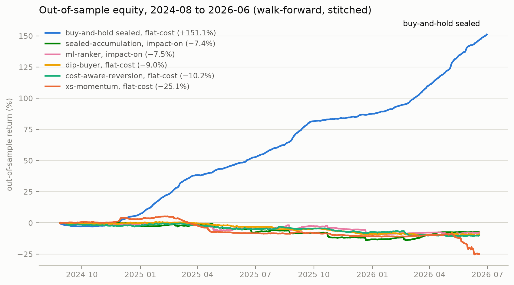
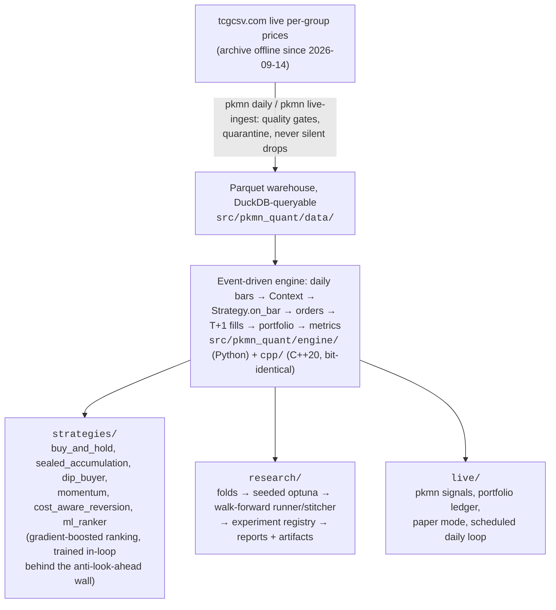
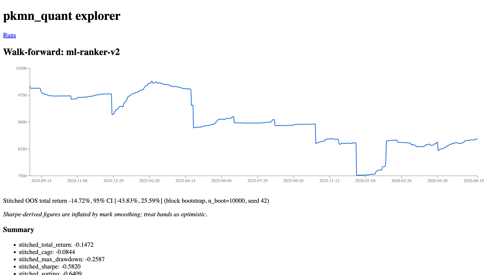

# pkmn_quant

**Event-driven backtesting for Pokemon card markets: a Python reference engine, a bit-for-bit-identical C++ engine, and walk-forward research honest enough to publish its own negative result.**

[](https://github.com/mlhv/pkmn-stock/actions/workflows/ci.yml)


<p align="center">
  
</p>

*Stitched out-of-sample equity, 2024-08 to 2026-06, **on the 23-group price universe this project used through 2026-08-03**. Each strategy shows its most rigorous available run at that time: sealed-accumulation and ml-ranker include the market-impact cost model, the rest are flat-cost, and the legend says which. This chart is kept as a historical artifact and every number in it has since moved twice — prices now cover all 217 tcgcsv groups, and the benchmark and buy-price instruments were repaired on 2026-08-09. See [Results](#results-walk-forward-out-of-sample-only) below for the current figures. Regenerate with `uv run --group viz python scripts/render_readme_chart.py`.*

## What this is

A quant research system for TCGplayer card prices (via tcgcsv.com), built end to end:

- **A custom event-driven backtest engine**: daily bars, T+1 fills, long-only, integer quantities, per-day liquidity caps tiered by price, ~12.75% sell fees plus shipping, and a walk-the-spread market-impact model that prices order size against the book.
- **A native C++20 engine** (nanobind) that reproduces the Python engine **bit for bit**. Every fill and every equity value must match with `==`, never a tolerance, enforced at three levels (unit, differential, full-data acceptance).
- **An 18x faster research loop**: a full walk-forward dropped from 6 minutes to 20 seconds, measured on the real 874-day / 23-group warehouse of the time, with fold-level parallelism that releases the GIL on the native path.
- **Real data at scale**: 908 daily snapshots (2024-02 to 2026-08) of every one of tcgcsv's 217 Pokemon groups: 36.4M price rows across 31,713 products, rebuilt from cached archives in 17 minutes and swapped in only after every pre-existing row was verified to reproduce bit-for-bit. tcgcsv took its price archive offline on 2026-09-14, so new days now come from its live per-group price endpoints, captured once per daily update (`pkmn live-ingest`, or `pkmn daily` four times a day); the days from 2026-09-14 to 2026-10-23 are lost, because the live endpoints only serve the current update.
- **Walk-forward validation only**: seeded optuna tunes parameters in-sample, they are frozen, then tested strictly out-of-sample. The headline curve contains zero in-sample days and every run reports its overfitting gap.
- **An experiment registry**: every run appends its config hash, git SHA, data fingerprint, and results to an append-only log (`pkmn runs list` / `pkmn runs show`), so any number in this README is reproducible.

> **The honest headline:** no active strategy has ever beaten buy-and-hold sealed product here — on either price universe, and now not even scored over its own holding windows. The comparison used to be soft in two ways the project has since fixed: the benchmark put only 4.7% of the account into product (an equal-weight integer-sizing artifact, so it was 95% idle cash), and buys were priced from `market`, a sales-derived print that on 2.19M rows sits *below* the cheapest listing anyone was actually offering. With a liquidity-screened benchmark that now holds **74.2% of the account in product and consumes 99.9% all-in** once fees and market impact are counted (**+24.93%**, 2024-03 to 2026-06, impact on, `warmup_days=0`) and buys floored at `max(market, low)`, all six strategies remain negative — and scored *per round trip against holding sealed over that trip's own entry and exit dates*, the answer over the owner's target 1-3 month window is a clear no: median edge −16.6% to −84.3% per trade on samples of 20-116 trips, beating the index on 0.9%-22% of them. Five of the six also got worse than before the repairs, which is the instrument working: they now pay the cheapest listing that existed. The system's value is that it can prove and dismantle its own results honestly: out-of-sample discipline, transaction-cost and market-impact realism, an explicit overfitting measurement, and reproducibility from a config hash.

## Results (walk-forward, out-of-sample only)

**Prices cover all 217 tcgcsv groups as of 2026-08-04** (previously 23: sets released since 2024). The universe is derived from what is priced, so widening ingestion widened every strategy's candidate set — 6,671 → 31,713 priced products, 3.2M → 36.4M price rows. **Two measurement instruments were then repaired (2026-08-09):** the benchmark's allocation rule (**4.7% → 74.2% of the account in product, 5.5% → 99.9% all-in**) and the price a buy executes at (now floored at the cheapest live listing). Deployment is quoted two ways on purpose and they must not be mixed: *notional* is what went into product, *all-in* adds fees and the market-impact charge, and under the new buy floor impact alone runs to roughly a third of notional — so about a quarter of the account is friction rather than inventory (impact is 25.3% of the account on its own; the remaining fraction of a point is fees). [Both percentages are from the superseded 2026-08-07 benchmark run and are pending the post-fix re-run.] All three columns are **impact-on** over the identical window (2024-03-01..2026-06-30, 11 folds, 15 trials). One asymmetry to know before reading the table: the six strategy rows are walk-forward runs at `warmup_days=120` while the benchmark row is a `pkmn backtest` at `warmup_days=0`, and the screened benchmark is warmup-sensitive — the same bar measures **+16.07% at warmup 120**. The direction is conservative (the published bar is the *harder* one) and nothing flips, but the figures are not warmup-matched; see the findings doc's Instrument repair section. Run IDs are in `data/runs/registry.jsonl` and cited in the findings doc.

| Strategy             | Stitched OOS, 23 groups | Stitched OOS, 217 groups | Stitched OOS, 217 groups + repaired instruments |
|----------------------|-------------------------:|--------------------------:|--------------------------:|
| buy-and-hold sealed  | *(backtest)* **+183.7%**<br>60.1% notional / 63.0% all-in | *(backtest)* **+10.5%**<br>4.7% notional / 5.5% all-in | *(backtest)* **+24.9%**<br>**74.2% notional / 99.9% all-in** |
| sealed-accumulation  | −7.4%                    | −8.6%                     | **−10.3%**                 |
| ml-ranker            | −5.1%                    | −81.6%                    | **−84.5%**                 |
| xs-momentum          | −9.3%                    | −38.7%                    | **−54.5%**                 |
| dip-buyer            | −21.2%                   | −99.8%                    | **−100.0%**                |
| cost-aware-reversion | −22.5%                   | −98.7%                    | **−99.98%**                |
| ml-ranker-v2         | −23.2%                   | −99.8%                    | **−99.4%**                 |

**The three benchmark numbers are not comparable to each other as returns.** They are the same command on the same market with three different amounts of capital actually at work: **60.1% → 4.7% → 74.2% notional**, or **63.0% → 5.5% → 99.9% all-in**. Read one basis or the other, never one from each — "4.7% → 99.9%" mixes them and overstates the repair (like-for-like it is 16x notional, not 21x). Only the third is a return on a substantially invested position, and it is the only one that should be used as a bar. **Five of the six strategies got worse under the repairs, and that is the instrument working, not a regression** — they now pay the cheapest listing that actually existed instead of a sales print nothing was offered at. (ml-ranker-v2's −99.8% → −99.4% is noise on a near-total loss.)

11 folds each: optimize 180 days in-sample, freeze params, test 60 days out-of-sample, roll, stitch the OOS segments. The overfitting gap (mean IS CAGR minus mean OOS CAGR) is reported on every run. White's Reality Check over the whole zoo is **p = 1.0000 on the 23-group universe, p = 0.8038 on the 217-group one, and p = 1.0000 again against the repaired benchmark** — each measured against its own era's bar, so the three are not a trend; the best candidate does not beat a typical best-of-six luck draw in any of them, and every deflated Sharpe stays far below the 0.5 coin-flip point. (All are far from the p ≤ 0.05 bar, but they are not the same number. This project once published 1.0000 where 0.8038 was correct — a recorded run with a registry record, `20260804T184401Z-cf292c`, not a draft: `pkmn evaluate` auto-discovers its benchmark by globbing a directory name, and the stale pre-swap directory was still on disk, so six post-swap strategies were scored against a pre-swap benchmark. The error made the test *harder*, never easier, so nothing published was flattered by it; the corrected run is `20260804T204825Z-fa07b8`. **That glob is now deleted**: `pkmn evaluate` resolves its benchmark from the run registry only — a registry record carries the config, git SHA and data fingerprint that make "is this bar comparable?" answerable, which a directory name cannot — skips the paired sidecar benchmarks tagged `benchmark_for`, and refuses a benchmark whose window does not span the strategies'. Full correction in the findings doc.)

### Does anything beat holding sealed over 1-3 months?

This is the question the project exists to answer, and a stitched 28-month return cannot: it scores a strategy that is in the market a third of the days against one that is in it all of them. `pkmn horizon` pairs a backtest's fills into FIFO round trips and scores each trip against holding the sealed index **over that trip's own entry and exit dates**.

| Strategy | round trips | median edge, all trips | win rate | **1-3m median edge** | **trips in 1-3m** |
|---|---:|---:|---:|---:|---:|
| sealed-accumulation | 33 | −10.98% | 33.3% | +13.90% | **1** |
| cost-aware-reversion | 132 | −39.25% | 15.9% | −16.57% | 41 |
| ml-ranker | 145 | −33.63% | 20.7% | −37.96% | 109 |
| xs-momentum | 106 | −44.02% | 6.6% | −45.33% | 99 |
| dip-buyer | 175 | −46.12% | 9.7% | −51.21% | 116 |
| ml-ranker-v2 | 20 | −84.32% | **0.0%** | −84.32% | 20 |

**The answer is no, and not narrowly.** The single positive 1-3m figure in the whole study is sealed-accumulation's **+13.90% over exactly one round trip**, against that strategy's own all-trip median of −10.98%; it is an anecdote and is never quoted without its sample size. Every strategy with a real sample in the band loses to simply holding the index over identical dates by 16.6 to 84.3 percentage points per trade, and beats it on 0.9%-22.0% of those trades. Method caveat, stated because it changes what these mean: walk-forward artifacts carry no `fills.parquet`, so these come from **default-parameter backtests** over the same window, not the walk-forward parameter sets.

**How the middle column came to be so misleading, and what fixed it.** The 23 → 217 group benchmark "fall" was mostly a sizing artifact: `BuyAndHold` equal-weighted the sealed universe with integer quantities, so 45 → 1,315 day-1 assets took the per-asset budget from $222 to $7.60 and deployed capital from 60.1% to 4.7% of a $10,000 account. Neither run was fully deployed — on the slice actually at risk the two returned +291.7% and +191.1% (gain / all-in capital consumed) — so about 85% of the 17x headline collapse was the sizing rule rather than the assets (log/Törnqvist decomposition of `return = deployment × invested-slice return`; Shapley gives 80%, order-dependent decompositions span 63-97%). The "new products are junk" explanation was falsified separately: among the 1,133 of 2,389 in-window sealed assets that priced across the whole window, the newly added ones returned a median +212% versus +171% for the pre-existing ones. **The benchmark now screens for tradeability and sweeps residual cash into the largest dollar deficit until nothing is affordable, taking notional deployment 4.7% → 74.2% and all-in 5.5% → 99.9%** — so the right-hand column is the first benchmark figure in this project that is a return on an invested account rather than on a cash sleeve.

**The strategies' near-total losses were an entry-price artifact too, and only half of it is fixed.** dip-buyer and cost-aware-reversion select on `market`, and 92-97% of their buy-side impact came from fills where the day's `market` print sits *below the lowest listing* — both are by construction maximizers over exactly the quantity that gap corrupts. Buys are now floored at `max(market, low)`, so those fills cost what the cheapest live offer cost; what is **not** fixed is that the strategies still *select* on a price they cannot transact at, which is a strategy-design question and untouched here. (Those impact figures come from fixed-parameter diagnostic probes, not from the walk-forward runs in the table, and the two ML strategies' losses were **never** diagnosed.) Full derivation, provenance for every derived figure, and the open questions: [docs/research-findings-2026-07.md](docs/research-findings-2026-07.md).

## Why the numbers are believable

- **No look-ahead by construction:** strategies receive a `Context` (history up to today, positions, cash) and cannot tell backtest from live mode.
- **Cost realism:** ~15% round-trip friction before impact; a buy's base price is floored at `max(market, low)` — `market` is sales-derived and `low` is the cheapest current listing, so you cannot lift an offer that does not exist — and the impact model then walks fills from that floor toward `mid` (buys) or from `market` toward `low` (sells), scaled by order size against the daily liquidity cap. Sells have no floor on purpose: tcgcsv publishes no bid series, so a symmetric fix would be fabricating a price. On the repaired benchmark, impact is 34% of buy notional. Opt out per-command with `--no-impact` — which also disables the buy floor, so flat-cost runs are a comparability tool, not a model of executable prices.
- **A bar that is actually invested:** the buy-and-hold benchmark screens the sealed universe for tradeability (print density, then relative spread) and sweeps residual cash into the largest dollar deficit, putting 74.2% of the account into product and consuming 99.9% of it once fees and impact are counted. It is deliberately **not** walk-forward-searchable: tuning the bar to maximise its own return would make every comparison against it self-serving.
- **Walk-forward only:** parameters are frozen before touching out-of-sample data; zero in-sample days in the headline curve.
- **Reproducible:** every run's config hash, git SHA (+dirty flag), and data fingerprint land in the registry.
- **Stated limitations:** ~2.5 years of data, one bull regime for sealed; Sharpe/Sortino are inflated by thin-market mark smoothing, now across 31,713 products rather than 6,671, so worse than before (documented in every report); tcgcsv publishes a daily `market` price whether or not anything sold, so "prints every day" (22,677 products) is not "trades every day"; ~6% of price rows have `market` below the day's lowest listing — buys are now priced at the listing, but no liquidity or quote-sanity filter screens those products out of any strategy's candidate set, and the selectors still rank on `market`; stitched seams assume mark-value carryover without liquidation costs. Methodology over significance.

## Architecture



The market-impact model lives in `engine/quotes.py`: a per-day `Quote` (mid/low) feeds walk-the-spread pricing (engine default off, CLI default on). Data throughout the pipeline is polars-backed; `research/features.py` adds 8 leakage-bounded features for ml-ranker (scikit-learn).

## Two engines, one result

The Python engine (`engine/backtest.py`) is the always-available reference. The C++ engine (`cpp/`, bound as `pkmn_quant._engine`) ports all five strategies natively. `pkmn backtest` is native-only (no `--engine` flag); `pkmn walkforward` still exposes `--engine cpp`/`--engine python`, defaulting to `cpp` since Plan 11. Anything else, including any raw Python `Strategy` such as ml-ranker, still runs correctly on the C++ event loop through a per-bar callback bridge.

**The parity guarantee is bit-for-bit, not "close enough".** Every fill's day, asset, quantity, price, fees, and impact, and every equity-curve value, must match exactly (`==`). Enforced three ways: Catch2 unit tests on the C++ core in isolation, differential tests across both engines for every strategy, and a full-data acceptance script over the real warehouse (874 days / 23 groups when that acceptance was run; 908 days / 217 groups today):

```bash
uv run python scripts/parity_full.py        # five rule strategies, ~1 min
uv run python scripts/parity_full.py --ml   # + ml-ranker bridge, ~2-3 min
```

The full-data acceptance run surfaced a real gap the synthetic fixtures never exercised: 40 priced product_ids inside the backtest window (1,845 warehouse-wide as of that run) had no matching `products.parquet` catalog row. Both engines now tag missing catalog rows kind `other`, so they agree bit-for-bit on which assets are tradeable; details in the findings doc's Plan 10 section. The underlying gap has since been **fixed** — the catalog now covers all 217 tcgcsv groups on every ingest, which took uncataloged priced products from 2,017 (the re-measured warehouse-wide figure) to 8 of 6,665 on the 23-group warehouse. On the current 217-group warehouse the residual is 112 of 31,713 (0.35%) — products that keep their price history but no longer appear in the catalog. The supported reading is that they were **delisted upstream** (all 112 stopped pricing before the warehouse's last day), but that reading was checked for consistency rather than proven; either way the kind-`other` tagging stays as the safety net for them.

**Measured single-backtest speedup** (best of 3, full 2024-03 to 2026-06 range, impact on, total wall-clock including the one-time data load):

| strategy | python (s) | cpp (s) | speedup |
|---|---|---|---|
| buy-and-hold | 10.34 | 4.37 | 2.4x |
| sealed-accumulation | 11.91 | 3.52 | 3.4x |
| dip-buyer | 27.44 | 3.60 | 7.6x |

**Measured walk-forward speedup** (`scripts/bench_walkforward.py`, sealed-accumulation, 11 folds, 15 trials per fold):

| config | wall-clock (s) | speedup |
|---|---|---|
| python, serial | 359.5 | 1.0x |
| cpp, serial | 20.0 | 18.0x |
| cpp, workers=auto | 20.5 | 17.5x |

`--workers` controls fold-level parallelism (0 = auto, 1 = serial, N = N threads); results are bit-identical at any worker count, and the serial/parallel equality is checked on real data by the benchmark itself. The honest detail: the 18x is almost entirely the native engine plus a data-prep hoist, not threads; the findings doc's Plan 11 section explains why. Use `--engine python --workers 1` for the reference behavior.

Build notes: `uv sync` builds the extension automatically (scikit-build-core + nanobind, CMake ≥ 3.26). For direct C++ iteration:

```bash
cmake -S cpp -B cpp/build -DPKMN_BUILD_TESTS=ON && cmake --build cpp/build -j
ctest --test-dir cpp/build --output-on-failure
```

## Quickstart

```bash
uv sync                                                   # installs everything, builds the C++ extension
uv run pytest                                             # 583 tests (+1 dashboard skip without --group dashboard; 588 with it)
uv run pkmn ingest --start 2024-02-08 --end 2026-08-03    # all 217 groups; hours from cold, ~36M price rows
uv run python scripts/rebuild_warehouse.py --root .       # ~17 min instead, if the raw archives are already cached
uv run python scripts/verify_rebuild.py --root .          # gate any swap: prices, quarantine decisions and catalog rows must all reproduce exactly
uv run pkmn refresh-products                              # repair the product catalog (all 217 groups, no prices)
uv run pkmn backtest --start 2024-03-01 --end 2026-06-30  # benchmark backtest: screened, ~74% notional / ~99.9% all-in (cpp engine, impact on)
uv run pkmn walkforward --strategy sealed-accumulation \
    --start 2024-03-01 --end 2026-06-30 --trials 15       # research run (fold-parallel by default)
uv run pkmn signals --strategy sealed-accumulation        # today's recommendations
uv run pkmn horizon <backtest-run-id>                     # per-trade edge vs holding sealed over each trade's own window
uv run pkmn runs list                                     # experiment registry
uv run pkmn portfolio show                                # real positions + P&L
uv run pkmn daily --skip-ingest --paper                   # paper-trade the full loop, offline
uv run --group dashboard streamlit run app/dashboard.py   # results explorer
```

<details>
<summary><strong>Scheduling the daily loop (macOS launchd)</strong></summary>

    sed "s|REPO_PATH|$(pwd)|" scripts/com.pkmn-quant.daily.plist \
        > ~/Library/LaunchAgents/com.pkmn-quant.daily.plist
    launchctl load ~/Library/LaunchAgents/com.pkmn-quant.daily.plist

Runs `pkmn daily` at 09:00, 13:00, 17:00 and 21:00 (or on next wake, if the
Mac was asleep): captures tcgcsv's live update if it is not stored yet, runs
signals against your ledger (`pkmn portfolio ...`) when a new day landed, and
notifies when there is something to act on or a problem worth acting on.
Notifications are a macOS banner, plus a phone push through ntfy if
`data/config/notify.toml` holds an `[ntfy]` topic (`pkmn notify-test` checks
it). After editing the plist, unload and reload the job for the change to
take effect.

Troubleshooting:

    launchctl start com.pkmn-quant.daily                        # fire immediately to test
    launchctl list | grep pkmn-quant                            # loaded? last exit code?
    launchctl unload ~/Library/LaunchAgents/com.pkmn-quant.daily.plist   # required before re-loading an edited plist

</details>

<details>
<summary><strong>Paper trading before real money</strong></summary>

Before committing real cash, run the loop with `--paper` first
(`uv run pkmn daily --skip-ingest --paper`, or a second launchd job pointing
at the same repo).  Paper mode routes all ledger reads and writes to
`data/portfolio/paper.jsonl`, auto-records fills using the same CostModel
as the backtester (shipping, marketplace fee, per-day liquidity cap), and
labels every output surface PAPER: the dashboard alerts strip, notification
titles, and the `daily-{date}-paper/` artifact directory.  Fill counts in
`daily.json` reflect recorded fills only (after liquidity and affordability
clipping, not raw recommendations), so a paper day where every order clips to
zero sends no notification.  Use it to watch the strategy trade fake money
through the identical pipeline before you act on any real recommendation.
All five strategies (sealed-accumulation, dip-buyer, cost-aware-reversion,
xs-momentum, ml-ranker) are portfolio-safe: each supports `--portfolio` for
exit signals against a real ledger and works with the paper daily loop.

</details>

## Web explorer

A research explorer over the experiment registry and walk-forward/evaluate
artifacts, with the ability to trigger new runs from the browser: browse
recorded runs, launch a parameterized backtest (any strategy, any params,
optional starting holdings) from a form generated off the strategy's
declarative parameter specs, watch it through a polling jobs queue, and open
the finished run's detail screen — equity curve overlaid with an
identical-starting-state buy-and-hold benchmark, seeded-exit markers, and a
paginated fills table. Also: drill into a single walk-forward run's
folds/equity curve/rigor CI, and compare the full strategy zoo's
deflated-Sharpe/Reality-Check numbers side by side. Stack: FastAPI
(`src/pkmn_quant/api/`, 11 endpoints) serving Pydantic-typed JSON, and a
React/TS single-page app (`web/`, 6 screens) with its own toolchain.

One-command dev (runs both the API and the web dev server together, Ctrl-C
stops both):

```bash
make web
```



This is a research tool, not a trading terminal: no strategy is claimed to
beat buy-and-hold, and a triggered run writes a real artifact directory plus
a run-registry record — there is no sandbox mode. Job state lives in memory
(a server restart loses the jobs queue, never the results); the product
search index is cached per process, so a fresh ingest needs a restart to
become searchable; and holdings that fail universe/mark validation surface
as a failed job rather than a form error.

## Market data: an IEX order book in C++

A separate track, started after the card research above, is building toward a limit-order-book simulator on real exchange data. The first piece is a C++20 price-time order book (`cpp/src/pkmn_book`) and an IEX market-data stack (`cpp/src/pkmn_md`) that decodes the order-by-order DEEP+ feed straight from gzipped pcapng captures and rebuilds every symbol's book. Only this first of four planned pieces exists; the matching simulator and everything built on it are not started.

**What it checks, and what it does not prove yet.** `iex_oracle` compares the rebuilt book against IEX's own DEEP price levels and TOPS best quotes at every checkpoint. On 2024-12-23 it evaluated 96,980,017 checkpoints, excluded 5,472 halt zero-quotes by name, and checked the other 96,974,545; 7,870 of those disagree (0.008%), across 8 symbols. The project's own success bar was a match at every checked point on a full real day, so **the oracle did not pass on that day** and the tool exits 1 (it exits 3 instead when the run itself is not valid, for example a sequence gap or a feed that produced no checks). That day was also not a full normal session: every symbol was halted at 10:22:29 ET, all three feeds restarted at 11:32:50 ET, DEEP+ carried only 80,992 messages after the restart against 50,878,184 before it, and the last book event is at 13:45:40 ET, well before the 16:00 ET close. Even a zero-mismatch run on it would arguably fall short of the bar, so the next oracle day should be an ordinary session. Of the 7,870, 7,819 follow a point at 09:48:38 ET where DEEP+ order ids start running backwards, which no IEX specification documents; the other 51 are three symbols (NVR, MKL, SEB) whose round lot is not 100, and those lots were inferred from TOPS itself, so the tool only applies them when asked. Details, the evidence, and the open options are in [docs/iex-oracle.md](docs/iex-oracle.md).

**Speed.** Decoding and applying the 50,959,176 DEEP+ messages in that day's capture, with the capture held in RAM, runs at 7,342,902 messages per second in the clean benchmark run (best of 3, 13.5% spread between runs). Per-message latency is the median run (by throughput) of 3 RAM runs: p50 83 ns, p99 626 ns, p99.9 6,448 ns and max 40,436,760 ns. It is measured with the ARM virtual counter (cntvct_el0, 24 MHz, so 41.7 ns per tick), whose empty read pair costs 10.5 ns in that run (9.5 to 11.9 ns across the three runs, and included in every figure). The p50 is only two ticks (plus or minus 50%), and the maximum is most likely the VM being descheduled. Replacing the book's node-based containers with a pooled arena, an open-addressing id table and contiguous price levels was measured against the old book in 9 interleaved pairs: best-case throughput went from 4,926,764 to 7,584,533 messages per second and the median timed cost per message from 184.3 to 121.5 ns, with the new book faster in all 9 pairs. The tail latency did not improve. Hardware is an Apple M1 Pro running a 7-vCPU OrbStack Ubuntu 24.04 arm64 VM, and run-to-run noise there is 10% or more (46.8% of the median across the nine runs, for the new book's throughput), so treat the gains as direction plus rough size. All of these figures are for that one incident day's message mix (mostly a morning session, see above), not a normal full session. Method and raw runs: [docs/benchmarks/iex-book.md](docs/benchmarks/iex-book.md).

Data provided for free by IEX. By accessing or using IEX Historical Data, you agree to the IEX Historical Data Terms of Use. The data is not redistributed here (`data/iex/` is gitignored); see [docs/iex-hist-terms.md](docs/iex-hist-terms.md).

## Feed handler: gap recovery over UDP multicast

The second piece of that track is a C++20 feed handler (`cpp/tools/feed_handler.cpp`, recovery core in `cpp/src/pkmn_md/gap_recovery.*`). A publisher replays the 2024-12-23 DEEP+ capture as UDP multicast, one datagram per IEX-TP payload and byte for byte unchanged, and drops packets on purpose with a seeded injector. The handler finds each gap by sequence number, holds the packets behind it, asks the publisher for the missing range over a TCP side channel, and applies every message in order. To check it, both the handler and a direct replay of the file take a digest of every resting order (price, quantity and queue position) at 508 points through the morning. Under 1% random loss (425,623 packets dropped, 421,146 gaps recovered, none unrecoverable) all 508 matched, at 657,789 messages per second end to end; under 100-packet burst loss (2,018,900 packets dropped) all 508 matched at 677,599 messages per second. A throughput run with the capture preloaded in RAM and no injected loss read 768,150 messages per second, but the publisher was the limit there, so that is a floor. This is loopback inside one VM, not a network. Recovery is by retransmit only, with no snapshot. The checkpoints are samples, and the 80,992-message epoch after the restart has none. The reference shares the decoder and order book code with the handler, so a match shows the transport and recovery are correct, not that the book agrees with IEX. Same incident-day capture as above. Details and run conditions are in [docs/benchmarks/feed-handler.md](docs/benchmarks/feed-handler.md).

Data provided for free by IEX. By accessing or using IEX Historical Data, you agree to the IEX Historical Data Terms of Use. The data is not redistributed here (`data/iex/` is gitignored); see [docs/iex-hist-terms.md](docs/iex-hist-terms.md).

## Pokemon order book

The backtester's default execution is now a price-time order book. tcgcsv publishes one quote per product per day, not an order book, so the resting orders are **modelled (synthetic, built from the day's tcgcsv quote)**; they are a model of the quote, never market data. Two checks back it. With a test-only exact ladder, book pricing matches the earlier walk-the-spread formula to 4.66e-10 dollars across 11.2 billion checks on 34.1 million real rows, and the five native strategies fill identically under both at default parameters. And encoding the warehouse into an ITCH-style wire file (`pkmn wire encode`, [docs/pokemon-wire-protocol.md](docs/pokemon-wire-protocol.md)) and replaying it builds the same ladders as the in-memory path, with no mismatches over 1,315,694 asset-days. This is an engine change, not a research result: no strategy number was re-run, and `--execution formula` keeps the old model. Measurements: [docs/benchmarks/pokemon-book.md](docs/benchmarks/pokemon-book.md).

## Engineering practices

- `uv` for everything; `ruff` lint + format; `mypy --strict` on `src/`; pytest + Catch2; CI runs all gates with `uv sync --frozen`.
- Golden regression tests pin exact engine numbers; any drift fails loudly.
- Frozen dataclasses for value objects; every backtest `Result` carries its cost model, so a run's assumptions travel with its numbers.
- Two-stage review per task and a written plan per feature (see `docs/superpowers/`).

## Future work

- **A liquidity / quote-sanity layer.** The wide universe contains ~6% of rows where `market` sits below the day's lowest listing; dip-buyer and cost-aware-reversion select straight into them. Buys are now *priced* at the listing, but nothing screens those products out of a strategy's candidate set. `research/screen.py` is the machinery this needs — running it as a universe filter is a separate full-zoo re-run and has not been done.
- **Fills in walk-forward artifacts.** A walk-forward run writes `stitched_equity.parquet` but no `fills.parquet`, so `pkmn horizon` cannot score a tuned parameter set — every horizon number above comes from a default-parameter backtest instead.
- Multi-marketplace data (eBay, PSA-graded)
- Docker
